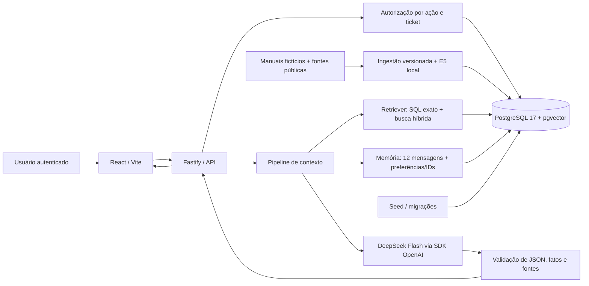

# Arquitetura do Fluxsus AI Lab

**Status:** arquitetura registrada antes da implementação. O projeto é uma simulação acadêmica local, sem conexão com sistemas da empresa, sem conteúdo clínico e sem dados de pacientes. As evidências de implementação e os resultados executados serão atualizados na documentação de avaliação e no relatório.

## Problema e fronteiras

A aplicação simula uma plataforma de processos hospitalares com chamados operacionais. O chatbot deve responder perguntas de uso do sistema e perguntas sobre tickets, mas só pode receber dados de tickets já autorizados para a pessoa autenticada. A necessidade central não é apenas encontrar texto parecido: identidade, permissão e estado atual do ticket precisam ser determinados antes de qualquer conteúdo ser enviado ao modelo.

O sistema contém dois fluxos que compartilham a mesma identidade e banco:

1. O painel permite autenticar, criar tickets, comentar, registrar andamento, resolver e encerrar tickets, além de conceder e revogar acessos explícitos.
2. O assistente classifica o pedido, consulta manuais ou dados estruturados, verifica autorização, monta o contexto e, quando necessário, chama DeepSeek. Cada resposta pode expor apenas fontes que o usuário ainda pode abrir.

O protótipo não atende solicitações clínicas, não recomenda conduta médica, não representa integração aprovada com Fluxsus real e não deve receber informações corporativas. O corpus e as contas são sintéticos. Essa fronteira mantém a atividade realizável sem dados de contrato e ajuda a avaliar o comportamento controlado em um domínio familiar.

## Componentes e responsabilidades

| Camada | Responsabilidade | Dado de entrada | Limite de segurança |
|---|---|---|---|
| Interface React/Vite | Login, chat, fontes, tickets, linha do tempo, conta e painel de concessões | Sessão HTTP e contratos compartilhados | Cargo exibido serve à navegação; não autoriza operações |
| API Fastify | Validar sessão, schema, origem e operações do produto | Cookies e corpo tipado | Usuário/role vêm da sessão verificada, nunca da mensagem |
| Serviço de autorização | Decidir ação sobre ticket, usuário e fonte | Identidade autenticada, role, participação, concessão ativa, estado | Negação por padrão; checagem por recurso e operação |
| PostgreSQL 17 + pgvector | Persistir usuários, sessões, tickets, eventos, conversas, memória e chunks vetoriais | Transações da API e migração/seed | Papel da API sem `SUPERUSER`/`BYPASSRLS`; RLS + consultas autorizadas |
| Pipeline de conhecimento | Preparar corpus, segmentar, gerar embeddings locais e indexar versões | Manuais fictícios e fontes OWASP declaradas | Proveniência, revisão de versão, sem misturar manual fictício com fato externo |
| Retriever | Recuperar ticket por chave exata ou trechos relevantes por busca autorizada | Pergunta, vetor e identidade autenticada | Aplicar autorização no SQL antes de construir o contexto |
| Gerenciador de contexto | Selecionar regras, identidade, memória útil, histórico e evidências | Mensagem atual e registros validados | Limite conservador; omite conteúdo de ticket cujo acesso foi perdido |
| Adaptador de geração | Chamar DeepSeek Flash pela API compatível com OpenAI | Prompt final sem segredos | Sem chave: não simular chamada; timeouts e respostas inválidas viram indisponibilidade |
| Validador e saída | Validar JSON, referências, estado e formato antes de persistir/exibir | Saída do provedor e IDs recuperados | Só aceita citações existentes e autorizadas; fatos atuais vêm do banco |
| Avaliação | Executar casos determinísticos, casos com provedor e comparação prompt/RAG | Casos versionados e resultados medidos | Distinguir teste offline/mock de chamada real paga |

## Diagrama do sistema

As setas para o modelo partem somente da pipeline, depois de filtragem de acesso e montagem do contexto. O banco mantém o dado atual do ticket; a busca vetorial melhora a localização de texto, mas não substitui a autorização nem se torna fonte de verdade para status.

## Tecnologias e justificativas

| Escolha | Uso no protótipo | Justificativa e custo de oportunidade |
|---|---|---|
| TypeScript | Contratos entre API e interface | Tipos comuns reduzem divergência de payloads; exigem build e validação em runtime para entradas externas |
| React + Vite | Interface local de chat e operações | Protótipo leve, permite verificar jornada real no browser; não é um desenho de implantação corporativa |
| Node.js 24 + Fastify | API HTTP | Plugins e schemas facilitam organizar rotas e validação; autorização segue explícita por serviço |
| PostgreSQL 17 | Persistência transacional | Chaves, integridade e transações combinam com tickets e histórico; evita manter um banco de permissões separado |
| pgvector 0.8.7 | Busca de embeddings no mesmo banco | Facilita aplicar filtros relacionais e RLS ao retrieval; Pinecone seria alternativa gerenciada para grande escala, com operação e política separadas |
| OpenAI SDK com `baseURL` DeepSeek | Geração | API compatível permite usar SDK comum mantendo provedor/modelo configuráveis; compatibilidade não garante suporte idêntico a todo parâmetro |
| DeepSeek `deepseek-flash` | Geração textual, thinking desativado | É o identificador oficial mais econômico listado na consulta de 12/10/2026; não é embedding. A tabela oficial indicava, por milhão de tokens, input sem cache US$0,15 fora de pico e US$0,30 em pico; output US$0,60 fora de pico e US$1,20 em pico. Valores mudam, então a execução paga precisa reconfirmá-los. [DeepSeek Models & Pricing](https://api-docs.deepseek.com/quick_start/pricing/) |
| Xenova multilingual E5 small + Transformers.js | Embeddings locais | Mantém o vetor fora do provedor de geração e funciona em português; adiciona download inicial e custo de CPU/memória local. Modelo base tem 384 dimensões; o formato ONNX está preparado para Transformers.js. [Modelo Xenova](https://huggingface.co/Xenova/multilingual-e5-small) |
| Vitest + PostgreSQL + Playwright | Testes | Unidade e autorização real no banco mais jornadas no browser; chamadas pagas são separadas, limitadas e etiquetadas |

**Acesso à tabela DeepSeek:** 12/10/2026. Preços oficializados por token em peak/off-peak e cache-hit/miss. A estimativa conservadora usa o pior preço aplicável e o teto de US$1 para a campanha de avaliação, com até 100 chamadas incluindo retries; uma reserva de custo tem de anteceder cada requisição.

## Fluxo de uma solicitação do início ao fim

1. A interface envia uma mensagem e, opcionalmente, o identificador da conversa. O browser envia o cookie HttpOnly; a requisição não traz cargo como prova de identidade.
2. A API verifica sessão, origem e formato. Uma sessão inválida encerra o fluxo antes de ler conversa ou ticket.
3. A pipeline detecta uma consulta determinística por ID de ticket ou uma pergunta que exige pesquisa semântica. Um caso fora do escopo recebe estado apropriado sem inventar resposta.
4. O servidor lê o role e abre transação vinculada à identidade. SQL e RLS filtram tickets por participação ou concessão ativa. Administrador não recebe leitura global apenas por cargo.
5. Para ID explícito, o estado vem da linha atual do ticket. Para linguagem natural, busca semântica/full-text combina candidatos permitidos; somente versões ativas e autorizadas podem seguir adiante.
6. O sistema carrega as 12 mensagens recentes permitidas, preferências explícitas e IDs recentes. Mensagens associadas a tickets com acesso expirado são omitidas. Eventos são recarregados para não transformar resumo em evidência factual.
7. O gerenciador preserva regras e pergunta, encaixa até cinco trechos em orçamento estimado de 8.000 tokens e separa instruções de conteúdo documental.
8. Se a pergunta exigir geração e a chave DeepSeek não estiver configurada, a API retorna disponibilidade/configuração pendente; não gera um resultado simulado. Consultas exatas podem responder deterministicamente.
9. A resposta estruturada do modelo é validada. Fontes citadas precisam pertencer ao conjunto fornecido e ser autorizadas ainda no momento da resposta; uma afirmação de estado precisa coincidir com o ticket atual.
10. Mensagem e referências são persistidas, a resposta é devolvida com `result`, fontes e `requestId`; a interface permite abrir cada fonte, momento em que a autorização é novamente checada.

## Contratos principais

Os contratos versionados e as rotas HTTP estão no [contrato aprovado](00-plano-e-contrato.md). As capacidades externas são: autenticar perfil; criar/consultar tickets autorizados; comentar e registrar transições; conceder/revogar acesso; manter conversa e preferências; responder no chat com estado, fontes e identificador de requisição. A API pública não deve confiar em `userId` ou `role` enviados pelo navegador, nem devolver corpo de ticket em uma operação de metadados de concessão.

## Decisões de arquitetura registradas (ADR)

### ADR-01: sistema completo fictício, sem integração corporativa

**Decisão:** implementar dados locais sintéticos e processos de suporte operacionais.

**Motivo:** a atividade requer domínio aplicável, mas o usuário está sob contrato e não pode usar registros empresariais reais. O protótipo permite validar comportamento sem levar dados para serviço externo. A chave da DeepSeek será fornecida pelo estudante e não é parte do corpus.

**Alternativa recusada:** ingestão de export de tickets da empresa. Exigiria acesso, autorização, classificação, tratamento de informação médica/pessoal e análise contratual que não fazem parte do escopo acadêmico.

**Consequência:** resultados comprovam apenas o comportamento no conjunto sintético; não demonstram que a futura empresa tenha a mesma regra ou desempenho.

### ADR-02: identidade de sessão e autorização antes de retrieval

**Decisão:** sessão opaca persistida, role carregada do servidor e autorização na API mais RLS no PostgreSQL.

**Motivo:** cargo e ID na mensagem ou no corpo são controláveis pelo cliente. O controle precisa proteger listagem, retrieval, histórico, citações e referências.

**Consequência:** toda operação autenticada abre contexto transacional local à identidade; o seed/migrador usa credencial distinta da conta usada em runtime.

### ADR-03: um banco para fatos, memória e vetores

**Decisão:** PostgreSQL 17 com pgvector armazena transações e recuperação.

**Motivo:** teste e política de acesso podem ser conferidos em uma transação; a versão atual e a linha do ticket continuam consultáveis mesmo após atualização de texto.

**Alternativas consideradas:** SQLite da demonstração de referência é simples, porém sem as políticas RLS necessárias; serviço vetorial externo seria apropriado se escala, isolamento ou topologia justificassem outra fronteira de operação.

### ADR-04: embedding local, geração gerenciada

**Decisão:** E5 multilíngue local para indexação e busca, DeepSeek para redação.

**Motivo:** reduz custo de embeddings em teste e a quantidade de conteúdo encaminhada a um terceiro; geração recebe apenas a pergunta e o contexto mínimo autorizado.

**Risco:** documentos recuperados que sejam incluídos na geração ainda saem do ambiente local. A aplicação é, por isso, somente demonstrativa com dados sintéticos; uma adoção real exigiria revisar termos, retenção, transferências e classificação de dados antes de envio.

## Proveniência e operação de conhecimento

O corpus tem três fontes públicas do OWASP e três documentos sintéticos de procedimento. O inventário, licença, origem, data de coleta, transformação, versão e classificação ficam na [documentação do corpus](03-corpus.md). Os guias públicos fundamentam princípios de segurança; não definem regras reais da plataforma. Regras do protótipo devem estar nos manuais sintéticos.

## Limites conhecidos

- A escala e a precisão são avaliadas em poucos casos sintéticos; não inferir prontidão para um hospital.
- A identidade é local e fictícia; não equivale a diretório corporativo, MFA ou federação.
- A geração usa serviço externo; nunca inserir segredo, prontuário, dado pessoal real ou informação contratual.
- Um limite de contexto não corrige uma autorização incorreta; o controle é prévio e independente da qualidade do prompt.
- Uma citação relevante apoia a frase no texto usado, mas não garante verdade fora do corpus nem substitui validação do responsável pelo processo.

